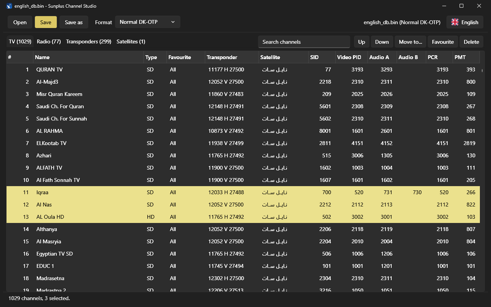
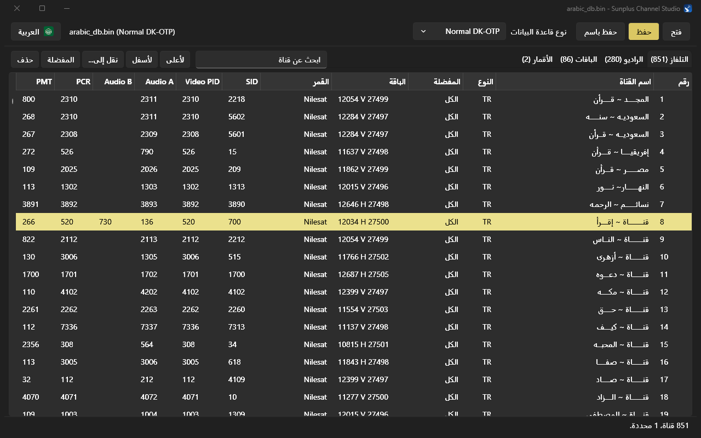
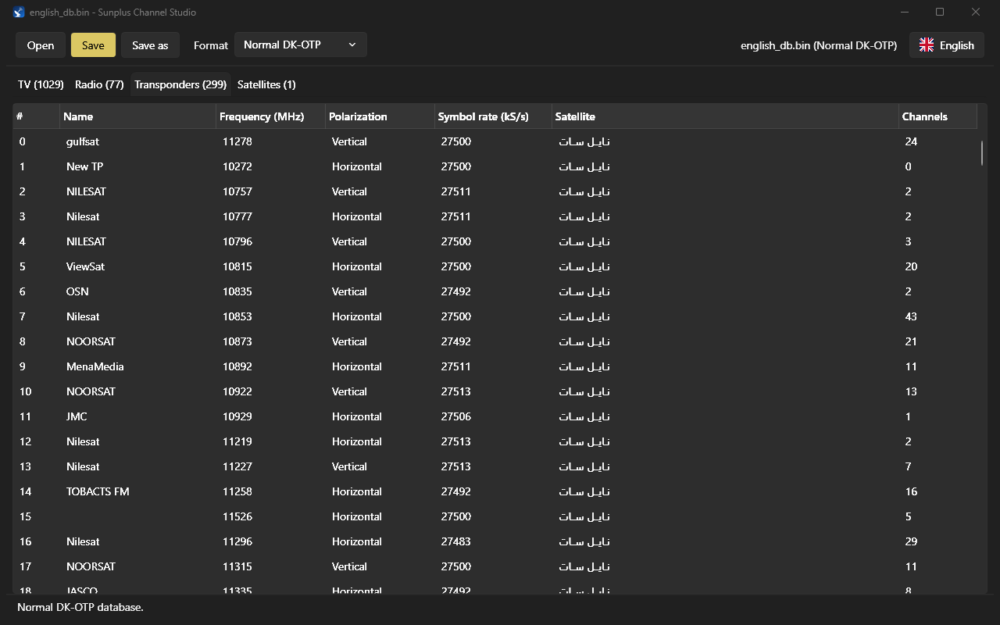
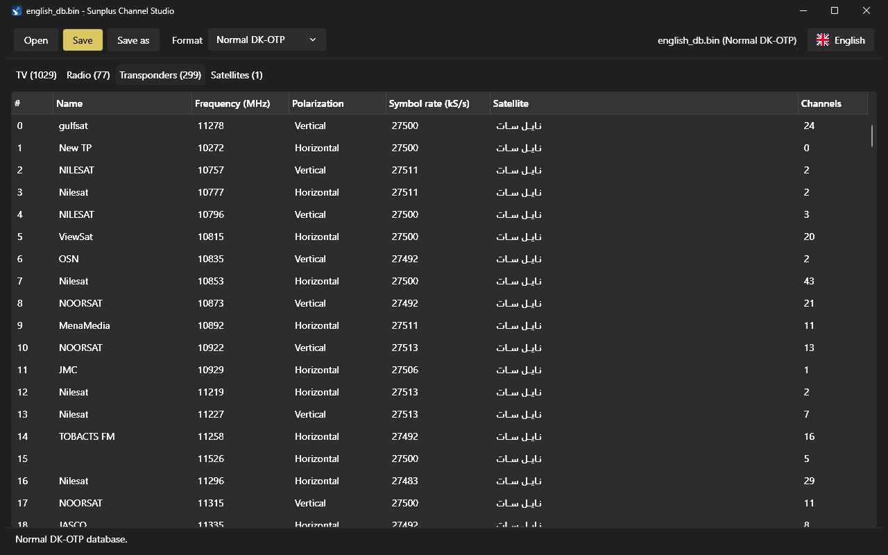
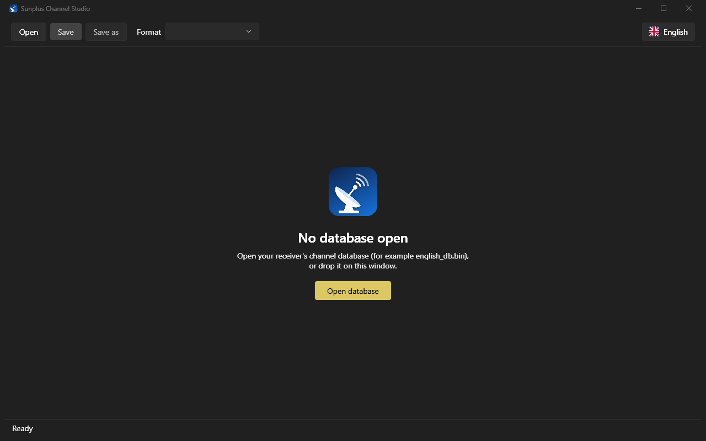

<div align="center">


# Sunplus Channel Studio

**A modern channel list editor for Sunplus DK satellite receivers.**

Rename, reorder, sort into favourites and clean up your receiver's channels on Windows, in English or Arabic.




</div>

## About

Many low-cost satellite receivers built on Sunplus DK chips keep their channel list in a small database file (`english_db.bin`, `arabic_db.bin` and similar). The tool that usually comes with them is an old Visual Basic 6 program with a cramped interface.

Sunplus Channel Studio is a fresh editor for the same files. It reads and writes them byte for byte the way the receiver expects, and gives you a clean Windows 11 style interface with search, drag and drop, and a full Arabic translation.

## Features

- **Drag and drop reordering.** Pick one channel or many and drag them where you want them. A line shows exactly where they will land, and the list scrolls when you reach the edge.
- **Fast search.** Filter thousands of channels by name as you type.
- **Rename in place.** Press F2 or double-click a name. Arabic names are written in the receiver's own Arabic encoding.
- **Favourite groups.** Put channels into All, News, Science, Sports, Movies, Kids, Music, Fashion or Financial.
- **Move to any position.** Send a channel or a whole selection straight to number 1, or anywhere else.
- **Transponders and satellites.** Edit transponder names, frequencies, symbol rates and polarization, and rename satellites.
- **All three database types.** Normal DK-OTP, Multistream V1 and Multistream V2 are detected automatically, and you can save to another type to convert a list.
- **Safe saving.** The first save keeps a `.bak` copy of the original file, and files are written through a temporary file so a failed save never leaves a broken database.
- **English and Arabic.** A complete Arabic interface with right-to-left layout. Pick a language from the toolbar; the app follows your Windows language until you do and remembers your choice.
- **Light and dark.** Follows the Windows theme and accent colour.

## Screenshots

<table>
  <tr>
    <td></td>
    <td></td>
  </tr>
  <tr>
    <td align="center">Full Arabic interface, right to left</td>
    <td align="center">Transponder editor</td>
  </tr>
  <tr>
    <td></td>
    <td></td>
  </tr>
  <tr>
    <td align="center">Radio channels</td>
    <td align="center">Open a file or drop it on the window</td>
  </tr>
</table>

## Getting started

### Requirements

- Windows 10 or Windows 11
- [.NET 10 Desktop Runtime](https://dotnet.microsoft.com/download/dotnet/10.0)

### Build and run

```bash
git clone https://github.com/medovanx/sunplus-channel-studio.git
cd sunplus-channel-studio
dotnet run --project SunplusChannelStudio
```

To make a standalone build:

```bash
dotnet publish SunplusChannelStudio -c Release -r win-x64 --self-contained false -o publish
```

## How to use

1. Copy the channel database from your receiver (for example over USB) to your computer.
2. Open it with **Open**, or drop the file on the window. You can also open it from the command line: `SunplusChannelStudio.exe english_db.bin`.
3. Edit the list, then **Save**. Use **Save as** to keep the original file untouched.
4. Load the saved file back onto the receiver the same way you normally do.

Always keep a copy of the original file. Loading a broken database onto a receiver can leave it with an empty channel list until you load a good one again.

### Keyboard shortcuts

| Action | Shortcut |
| --- | --- |
| Open a database | `Ctrl+O` |
| Save | `Ctrl+S` |
| Save as | `Ctrl+Shift+S` |
| Search channels | `Ctrl+F` |
| Rename | `F2` |
| Move up or down | `Ctrl+Up`, `Ctrl+Down` |
| Move to a position | `Ctrl+M` |
| Delete | `Del` |

## Project layout

| Folder | What it holds |
| --- | --- |
| `SunplusChannelStudio.Core` | The database format: reading, writing, DVB text encoding, reordering. No UI. |
| `SunplusChannelStudio` | The WPF desktop app. |
| `SunplusChannelStudio.Tests` | xUnit tests for the format and the reordering logic. |
| `docs` | The file format description and screenshots. |

The database format is described in [docs/FORMAT.md](docs/FORMAT.md).

### Running the tests

```bash
dotnet test
```

To also round-trip your own databases, point `SCS_SAMPLES` at a folder of `*_db.bin` files:

```bash
SCS_SAMPLES=/path/to/databases dotnet test
```

## Acknowledgements

The file format was worked out from the original STB Channel Editor for Sunplus DK receivers by Khaled Mtair and Abdel Hamid ElFeel, which the community has used for years. Sunplus Channel Studio is a new program written from scratch and shares no code with it.

Language flags come from [flag-icons](https://github.com/lipis/flag-icons) (MIT); see [THIRD-PARTY-NOTICES.md](THIRD-PARTY-NOTICES.md).

## Disclaimer

This project is not affiliated with Sunplus or any receiver maker. Editing your receiver's files is at your own risk.

---

<div dir="rtl" align="right">

## بالعربية

**Sunplus Channel Studio** محرر حديث لقوائم القنوات في أجهزة الاستقبال التي تعمل بشرائح Sunplus DK.

يمكنك من خلاله إعادة تسمية القنوات وترتيبها بالسحب والإفلات، وتقسيمها إلى مجموعات المفضلة، وتعديل الباقات والأقمار، والبحث السريع بين آلاف القنوات. يدعم البرنامج الأنواع الثلاثة لقواعد البيانات (Normal DK-OTP و Multistream V1 و Multistream V2) ويحفظ نسخة احتياطية من الملف الأصلي عند أول حفظ.

الواجهة متوفرة بالكامل باللغة العربية من اليمين إلى اليسار، ويمكنك التبديل بين العربية والإنجليزية من زر اللغة في شريط الأدوات.

</div>
